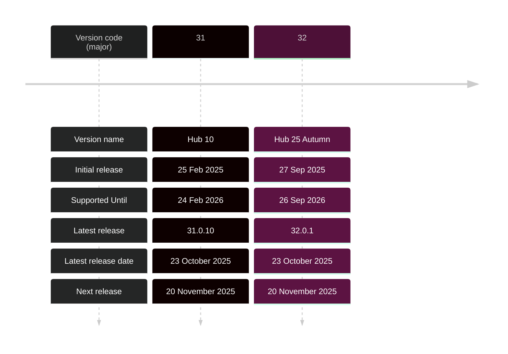
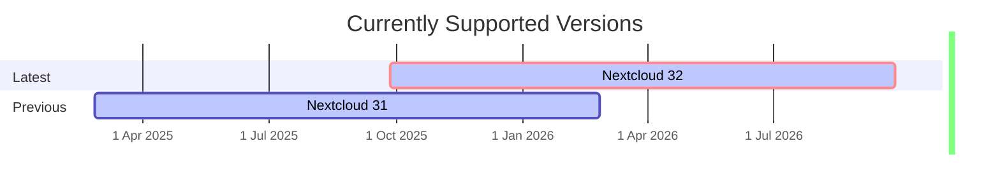

## Currently supported versions

New major versions are published every four months and are supported for one year through monthly maintenance releases. Maintenance releases are published for all still supported major versions and target all known critical bugs and security problems.

Major versions that have reached their **End of Life** no longer receive further bug fixes or security updates.

For more details to help with planning your updates, check the [documentation page](https://docs.nextcloud.com/server/stable/admin_manual/release_schedule.html).

| Version code | Version name  | Release date      | End of life      | Current version          | Next version
|:------------:|:-------------:|:------------------|-----------------:|-------------------------:|--------------------------:
| **32**       | Hub 25 Autumn | 2025-09-27        | 2026-09          | **32.0.1** (2025-10-23)  |  **32.0.2**  (2025-11-20)
| **31**       | Hub 10        | 2025-02-25        | 2026-02          | **31.0.10** (2025-10-23) |  **31.0.11** (2025-11-20)

<!--

|            | Date          | Info
|:-----------|:--------------|:-----------------------------------------------------------------
| **Daily**  | 2025-01-03    | External API freeze (relevant changes for other teams and app devs, like OCP and REST)
| **Beta 1** | 2025-01-07    | Feature freeze, base for screenshots for launch marketing
| **Beta 2** | 2025-01-09    |
| **Beta 3** | 2025-01-14    |
| **Beta 4** | 2025-01-16    |
| **Beta 5** | 2025-01-21    |
| **RC 1**   | 2025-01-23    | String freeze, Branch-off
| **RC 2**   | 2025-01-30    |
| **RC 3**   | 2025-02-06    |
| **RC 4**   | 2025-02-13    |
| **RC 5**   | 2025-02-20    |
| **Final**  | 2025-02-25    |

-->

## EOL Versions

📣 Hub 6 (27.1.x) was the successor to Hub 5 (27.0.x)

| Version code | Version name | Release date      | End of life      | Last version
|:------------:|:------------:|:------------------|-----------------:|-------------------------:
| **30**       | Hub 9        | 2024-09-11        | 2025-10          | 30.0.17 (2025-10-23)
| **29**       | Hub 8        | 2024-04-24        | 2025-04          | 29.0.16 (2025-04-17)
| **28**       | Hub 7        | 2023-12-12        | 2024-12          | 28.0.14 (2024-12-12)
| **27**       | Hub 6        | 2023-06-13        | 2024-06          | 27.1.11 (2024-06-25)
| **26**       | Hub 4        | 2023-03-21        | 2024-03          | 26.0.13 (2024-03-28)
| **25**       | Hub 3        | 2022-10-19        | 2023-10          | 25.0.13 (2023-10-26
| **24**       | Hub 3        | 2022-05-03        | 2023-04          | 24.0.12 (2023-04-20)
| **23**       | Hub 2        | 2021-11-30        | 2022-12          | 23.0.12 (2022-12-08)
| **22**       | Hub          | 2021-07-06        | 2022-07          | 22.2.10 (2022-07-18)
| **21**       | Hub          | 2021-02-22        | 2022-02          | 21.0.9 (2022-02-15)
| **20**       | Hub          | 2020-10-03        | 2021-11          | 20.0.14 (2021-11-11)
| **19**       | Hub          | 2020-06-03        | 2021-06          | 19.0.13 (2021-07-01)
| **18**       | Hub          | 2020-01-16        | 2021-01          | 18.0.14 (2021-01-27)
| **17**       | 17           | 2019-09-30        | 2020-10          | 17.0.10 (2020-10-08)
| **16**       | 16           | 2019-04-25        | 2020-06          | 16.0.11 (2020-06-04)
| **15**       | 15           | 2018-12-10        | 2019-12          | 15.0.14 (2019-12-19)
| **14**       | 14           | 2018-09-10        | 2019-09          | 14.0.14 (2019-08-15)
| **13**       | 13           | 2018-02-06        | 2019-02          | 13.0.12 (2019-02-28)
| **12**       | 12           | 2017-05-22        | 2018-11          | 12.0.13 (2018-11-22)
| **11**       | 11           | 2016-12-13        | 2018-03          | 11.0.8 (2018-03-15)
| **10**       | 10           | 2016-08-25        | 2017-08          | 10.0.6 (2017-08-07)
|  **9**       |  9           | 2016-08-03        | 2017-08          | 9.0.58 (2017-04-24)

---

